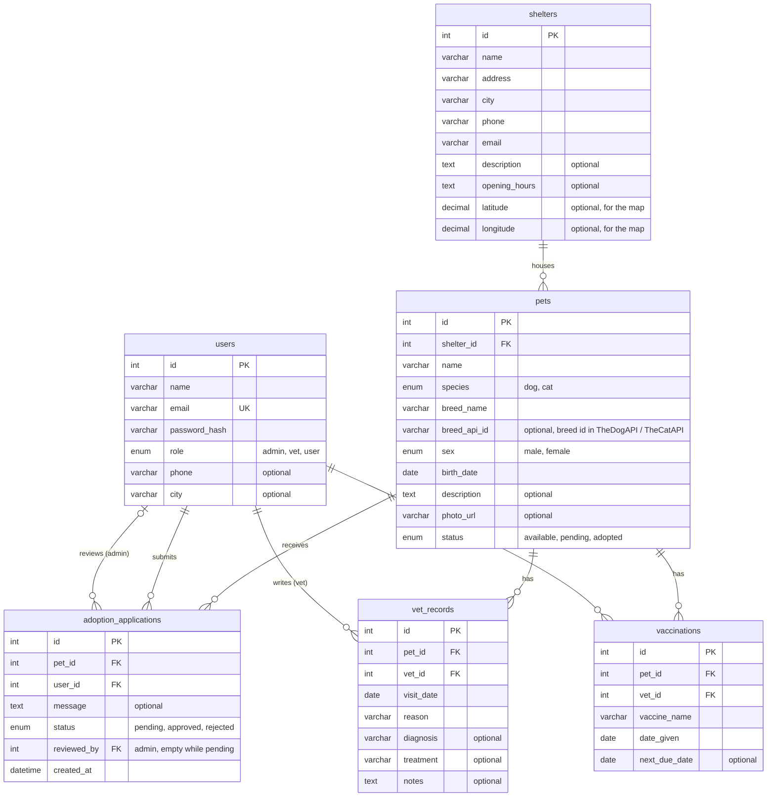

# PawFriends: Entity-Relationship Diagram

The database as it was built in Milestone 2. The exact type and length of every column are in [backend/database/pawfriends.sql](../backend/database/pawfriends.sql). Columns marked "optional" may be empty (NULL); all other columns are required.

PawFriends has 6 entities: `users`, `shelters`, `pets`, `adoption_applications`, `vet_records` and `vaccinations`.

## How to read the diagram

- **PK** is the primary key, **FK** a foreign key, **UK** a unique column.
- The line ends show how many records can be on that side:
  - `||` exactly one
  - `|o` zero or one
  - `o{` zero or more

  For example, `shelters ||--o{ pets` means a pet belongs to exactly one shelter, and a shelter has zero or more pets.

## Relationships

| Relationship | Type | Foreign key |
|---|---|---|
| A shelter houses many pets | one-to-many | `pets.shelter_id` → `shelters.id` |
| A pet receives many adoption applications | one-to-many | `adoption_applications.pet_id` → `pets.id` |
| A user submits many adoption applications | one-to-many | `adoption_applications.user_id` → `users.id` |
| An admin reviews many adoption applications | one-to-many (optional) | `adoption_applications.reviewed_by` → `users.id` |
| A pet has many vet records | one-to-many | `vet_records.pet_id` → `pets.id` |
| A vet writes many vet records | one-to-many | `vet_records.vet_id` → `users.id` |
| A pet has many vaccinations | one-to-many | `vaccinations.pet_id` → `pets.id` |
| A vet gives many vaccinations | one-to-many | `vaccinations.vet_id` → `users.id` |

**All foreign keys use `ON DELETE RESTRICT`:** a row can't be deleted while other rows point to it. For example, a shelter that still has pets, or a pet with applications or health records, can't be deleted.

**Users and pets are many-to-many:** a user can apply for many pets, and a pet can get applications from many users. `adoption_applications` is the table between them, and it also stores the application's own data (message, status, reviewer, date).

## Design decisions

- **The role is a column in `users`**, not a separate table. There are exactly three fixed roles, so an ENUM is simpler, and the role goes straight into the JWT token.
- **Vets and admins are users.** `vet_id` and `reviewed_by` point to `users.id`, so everyone logs in the same way and there are no separate vets or admins tables.
- **There is no `breeds` table.** Breed details (temperament, life span, origin, photo) come from TheDogAPI or TheCatAPI. A pet stores only `breed_name` (for display and search) and `breed_api_id` (to fetch the details). `breed_api_id` is text because TheCatAPI's breed ids are short codes such as `abys`, while TheDogAPI uses numbers. It's optional because a mixed-breed pet has no breed in the API.
- **`species` is only dog or cat**, because it decides which of the two APIs is called.
- **`reviewed_by` is empty while an application is pending.** It's filled in when an admin approves or rejects the application.
- **Vet records and vaccinations are separate tables** because they have different fields. A vaccination has a `next_due_date`, which the vet dashboard uses for follow-ups. A vet visit has a reason, diagnosis and treatment.
